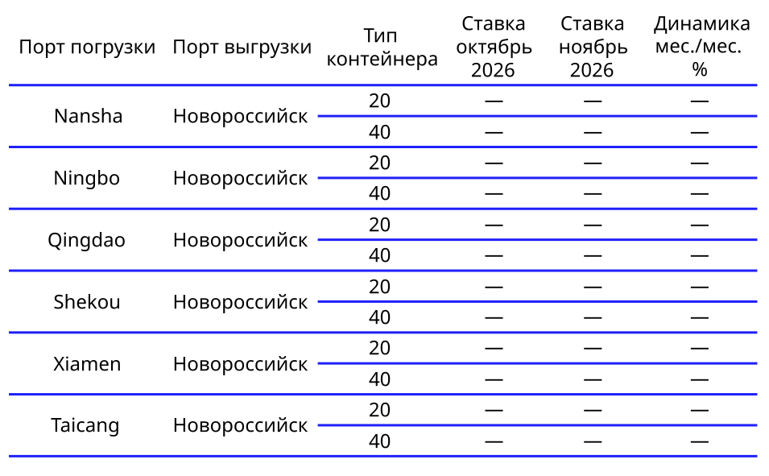

#  Морская логистика. Контейнеры {.my-custom-class style="margin-left:3%;"}

[Демоподписка](../demo-subscription.qmd)

:::::: {.grid style="margin-left:0%"}
::: {.g-col-12 .g-col-sm-12 .g-col-xs-12 .g-col-xl-6 .g-col-md-6 .g-col-lg-6}
### Котировки

*16.11.2026*

**Фрахт завершил осенний марафон с чемпионскими показателями**

- Показатели перевалки в Балтийском бассейне находятся на максимуме с 2022 г. Появление новых маршрутов и грузов удерживает ставки от снижения.
- Индийское направление продолжает дорожать на фоне дефицита провозной мощности.
- Перевозчики объявили о введении ледовой надбавки.
- Повышенный спрос на перевозки карбамида привел к резкому росту цен на маршруте.

{width="6%"} [Подробнее](../demo-subscription.qmd)

*15.10.2026*

**Балтийский ренессанс на фоне черных времен в Черном море**

- Перевалка контейнеров на юге России в сентябре сократилась на треть, обновив исторический минимум.
- Ставки на импортные перевозкиз Азии в Санкт-Петербург удерживаются на высоком уровне из-за дефицита провозной мощности.
- Рост интереса к маршруту через СМП подталкивает перевозчиков к запуску регулярных сервисов.
- Цены на логистику из Индии на историческом максимуме, при этом, несмотря на высокие цены, мест на судах практически нет.

{width="6%"} [Подробнее](../demo-subscription.qmd)

*15.09.2026*

**Контейнер ищет новые маршруты. Снова.**

- Из-за проблем с судоходством в Черном море объемы перевалки контейнеров в августе заметно снизились. Экспортная перевозка грузов в контейнерах значительно сократилась, а каждый второй экспортный контейнер на Балтике и Дальнем Востоке в августе был отправлен порожним.
- На фоне перестройки контейнерной логистики импортный фрахт из Индии обновил постковидный уровень.
- В связи с низкой ликвидностью рынка ЦЦИ приостанавливает публикацию стоимости контейнерной логистики в порту Новороссийск.

{width="6%"} [Подробнее](../demo-subscription.qmd)

:::

::: {.g-col-12 .g-col-sm-12 .g-col-xs-12 .g-col-xl-6 .g-col-md-6 .g-col-lg-6}

### События

*7 февраля 2025. Пятница с Центром ценовых индексов. Логистика*

[Материалы →](../events/2025-02-07-logistics.qmd)
:::

::: {.g-col-12 .g-col-sm-12 .g-col-xs-12 .g-col-xl-6 .g-col-md-6 .g-col-lg-6}
### Методология

[Методология ценовых индикаторов](../methodology/methodology-benchmark-pbc.qmd)

[Спецификация ставок морского фрахта](../methodology/specs-freight.qmd)
:::
::::::
