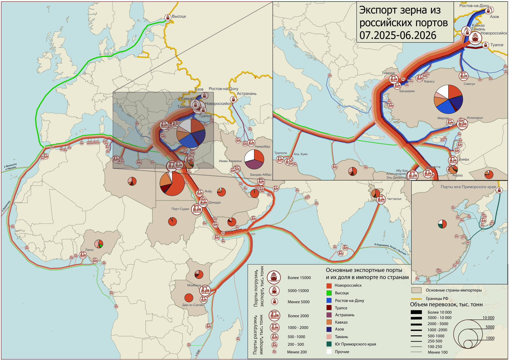
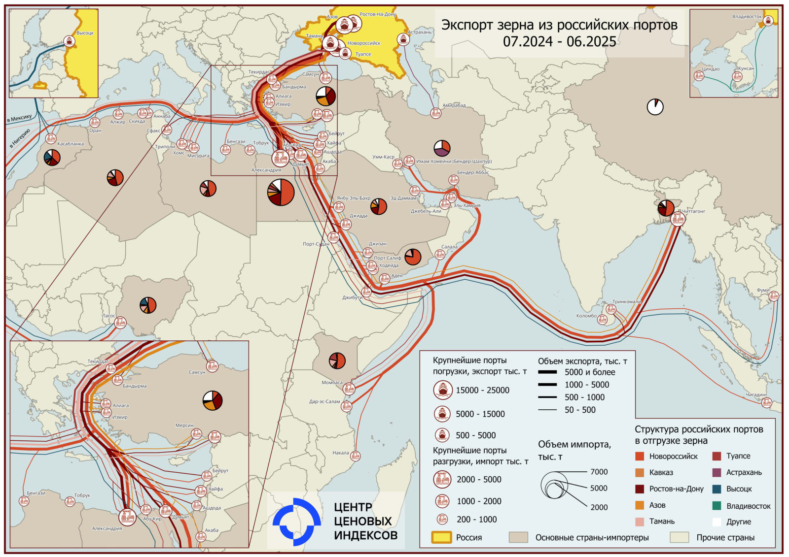

#  Зерно {.my-custom-class style="margin-left:3%;"}

[Демоподписка](../demo-subscription.qmd)

::::: {.grid style="margin-left:0%"}
::: {.g-col-12 .g-col-sm-12 .g-col-xs-12 .g-col-xl-6 .g-col-md-6 .g-col-lg-6}
### Котировки

*09.11.2026 Пшеница*

**Махачкала нарастит зерновые мощности, Аргентина -  на пике**

В четвертом квартале 2028 г. будет запущен зерновой терминал мощностью 1,5 млн т в Махачкалинском порту. 

Россия нарастила поставки пшеницы в Китай за 9 мес. 2026 г. в 4 раза до 79 тыс. т и вошла в ТОП-5 поставщиков. 

Объем переработки пшеницы в Аргентине на фоне рекордного урожая вырос до максимума последних 12 сезонов – 5,6 млн т. 

{width="6%"} [Подробнее](../demo-subscription.qmd)


*02.11.2026 Пшеница*

**Мурманск открылся для пшеницы, Азов приоткрылся**

Мурманский порт принял первую партию зерна – 3,4 тыс. т пшеницы.

Российские власти выдали разрешения на выход судов с зерном из Азовского моря, пока срок разрешений  - до 15 ноября 2026 г. 

С начала зерновых интервенций в России закуплено 38,3 тыс. т пшеницы. 

{width="6%"} [Подробнее](../demo-subscription.qmd)

*26.10.2026 Пшеница*

**Куда ведет Modern Way российского зерна?**

Логистический оператор Modern Way предложил экспортировать российское зерно в контейнерах через порт Очамчира в Абхазии. 

Фьючерсы на мягкую пшеницу CBOT опустились к концу прошлой недели до минимума с середины июля 2026 г. – около 230 долл./т. 

Аргентина может получить в 2026/27 г. второй рекордный урожай за последние 17 лет – 23,8 млн т.

{width="6%"} [Подробнее](../demo-subscription.qmd)

:::

::: {.g-col-12 .g-col-sm-12 .g-col-xs-12 .g-col-xl-6 .g-col-md-6 .g-col-lg-6}
```{=html}
<!-- временно скрыт пустой график
#### Динамика цен экспортной альтернативы к FOB Новороссийск пшеницы 12,5%, руб./т
-->
```

```{r,warning = FALSE, echo = FALSE, message = FALSE, eval = FALSE}

library(highcharter)
library(openxlsx)
library(tidyr)

# df <- read.xlsx(xlsxFile = '../xls/график_пшеница.xlsx', sheet = 1, detectDates = TRUE) 
# names(df) = c('date', 'value')
# df$date <- as.Date(df$date, origin = "1899-12-30")
# df$date <- as.Date(df$date, '%d.%m.%Y')
# df$value <- round(df$value,1)
#

df <- read.xlsx(xlsxFile = '../data/Исходные данные.xlsx', sheet = "Рынки", detectDates = TRUE)
#unique(df$Наименование.показателя)
id = "Пшеница 12,5% Netback Алтайский край"
df = df[df$Наименование.показателя == id,]
df$Дата <- as.Date(df$Дата)
df$Данные <- round(as.numeric(df$Данные), 1)
df = df[!is.na(df$Дата) & !is.na(df$Данные), c("Дата", "Данные")]
df = df[order(df$Дата), ]

hc = highchart() %>%
   hc_add_series(df, type = "line", hcaes(x = Дата, y = Данные), color = c("#1A4AFC"),
               name = c('Нетбэк Алтайский край'), marker = list(enabled = FALSE)) %>%
   hc_xAxis(type = 'datetime') %>%
   hc_yAxis(title  = list(text = 'руб./т')) %>%
   hc_exporting(enabled = FALSE) %>%
   hc_tooltip(enabled  = TRUE)

# поменять названия месяцев на русские. по умолчанию - на английском
hc$x$conf_opts$lang$months = c("Январь"	,"Февраль",	"Март"	,"Апрель"	,"Май",	"Июнь", "Июль",	"Август",	"Сентябрь",	"Октябрь",	"Ноябрь",	"Декабрь")
hc$x$conf_opts$lang$shortMonths = c("Янв", 	"Фев",	"Мар",	"Апр",	"Май",	"Июн",	"Июл",	"Авг",	"Сен",	"Окт",	"Ноя",	"Дек")

hc

```

### Карта экспорта зерна из портов, 2025–26 гг.

<a href="../pdf/Карта%20ЦЦИ%20экспорта%20зерна%20из%20портов%202025-26%20г.pdf" target="_blank"></a>

[Открыть карту](../pdf/Карта%20ЦЦИ%20экспорта%20зерна%20из%20портов%202025-26%20г.pdf){target="_blank"}

### Карта экспорта зерна из портов, 2024–25 гг.

<a href="../pdf/Карта%20ЦЦИ%20экспорт%20зерна%20из%20портов%20РФ%20в%202024-2025%20г.pdf" target="_blank"></a>

[Открыть карту](../pdf/Карта%20ЦЦИ%20экспорт%20зерна%20из%20портов%20РФ%20в%202024-2025%20г.pdf){target="_blank"}

### События

*13 сентября 2024. Пятница с ЦЦИ: хлеб с маслом*

[Материалы →](../events/2024-09-13-wheat.qmd)
:::
:::::

::::: {.grid style="margin-left:0%"}
::: {.g-col-12 .g-col-sm-12 .g-col-xs-12 .g-col-xl-4 .g-col-md-6 .g-col-lg-6}
### Морская логистика

[Фрахт зерна](freight-wheat.qmd)

[Перевалка зерна](markets-sea-wheat-ports.qmd)

### Методология

[Методология ценовых индикаторов](../methodology/methodology-benchmark-pbc.qmd)

[Спецификация котировок на пшеницу](../methodology/specs-wheat.qmd)
:::

::: {.g-col-12 .g-col-sm-12 .g-col-xs-12 .g-col-xl-4 .g-col-md-6 .g-col-lg-6}
:::
:::::
